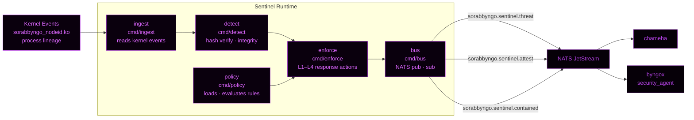
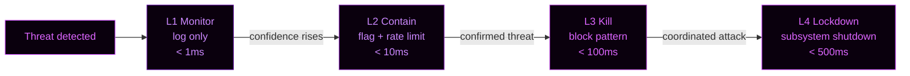

<p align="center">
  
</p>

<p align="center">
  <strong>Sentinel Runtime — Ring 2 Attestation Engine</strong><br/>
  Process integrity · Hash-chain audit · Signed attestation · NATS decision pipeline
</p>

<p align="center">
  
  
  
  
  
</p>

---

Runtime attestation engine for Sorabbyngo OS. Verifies process identity, checks runtime integrity, produces signed attestation reports, and publishes findings to the Sentinel decision pipeline via NATS.

---

## Pipeline architecture



---

## Services

| Service | Binary | Role |
|---|---|---|
| `ingest` | `cmd/ingest` | Reads kernel events, process lineage |
| `detect` | `cmd/detect` | Hash verification, integrity checks |
| `enforce` | `cmd/enforce` | Executes L1–L4 response actions |
| `bus` | `cmd/bus` | NATS publisher and subscriber |
| `policy` | `cmd/policy` | Loads and evaluates policy rules |

---

## Response ladder

| Level | Action | Latency target |
|---|---|---|
| L1 | Monitor — log only | < 1ms |
| L2 | Soft contain — flag + rate limit | < 10ms |
| L3 | Kill + block pattern | < 100ms |
| L4 | Subsystem lockdown | < 500ms |



---

## Attestation report

Every verified process produces a signed attestation report published to NATS:

```json
{
  "pid":        1234,
  "comm":       "python3",
  "exe_hash":   "sha256:abc123...",
  "node_id":    "fc035f19...",
  "sealed":     true,
  "response":   "L2_CONTAIN",
  "confidence": 0.87,
  "timestamp":  1712345678,
  "signature":  "ed25519:..."
}
```

---

## NATS subjects

| Subject | Direction | Description |
|---|---|---|
| `sorabbyngo.kcp.>` | Subscribe | Raw kernel events from KCP |
| `sorabbyngo.sentinel.threat` | Publish | High-confidence threats |
| `sorabbyngo.sentinel.contained` | Publish | Contained / monitored events |
| `sorabbyngo.sentinel.attest` | Publish | Signed attestation reports |
| `sorabbyngo.sentinel.learned` | Publish | Learning updates |

---

## Build and run

```bash
# Build all services
go build ./cmd/ingest
go build ./cmd/detect
go build ./cmd/enforce
go build ./cmd/bus
go build ./cmd/policy

# Run full runtime
./sentinel-runtime
```

---

## Related repositories

| Repo | Ring | Role |
|---|:---:|---|
| `security` | — | 7-ring master architecture |
| `sorabbyngo-cyberwall` | 7 | Publishes threat alerts sentinel consumes |
| `cml` | 4 | Safety filter — sentinel enforces CML decisions |
| `identity-core` | 3 | SUID used in every attestation report |
| `sorabbyngo-os` | 1 | Kernel events — source of all ingest data |
| `byngox` | — | security_agent receives escalation from sentinel |

---

<p align="center">
  <strong>Sorabbyngo Company</strong> · Kisii, Kenya · 2026<br/>
  <em>Rhythm of Digital Life</em>
</p>
